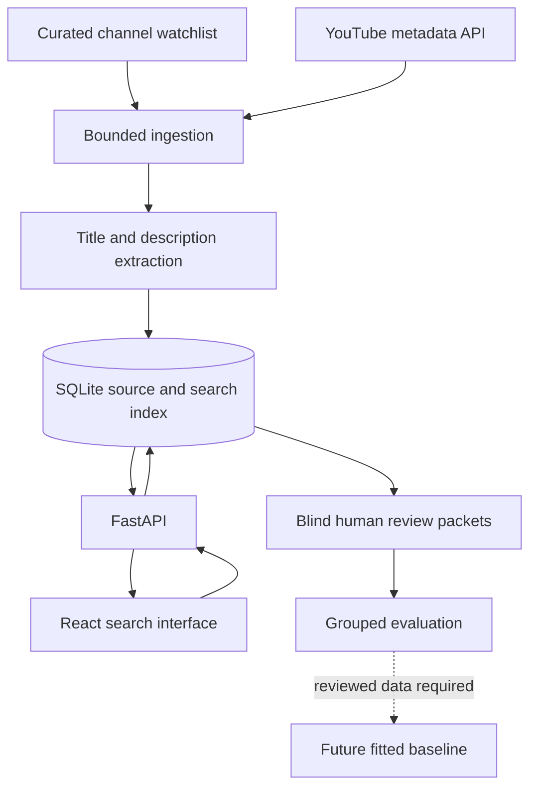

# PrizeScout architecture

PrizeScout separates collecting sources from answering searches. User requests
query the local SQLite index and never call YouTube. The extractor currently uses
rules and hand-set scoring; no trained model or independent legitimacy assessment
is deployed.

## Data collection

`src/youtube_client.py` retrieves channel identities, upload pages and video
metadata. Each request attempt is charged before network I/O. Errors are sanitized
so API keys and key-bearing URLs do not enter logs.

`src/ingestion.py` applies per-run and Pacific-day quota caps, persists every
source including rejected inputs, and saves durable upload cursors. It refreshes
older inputs and removes deleted/private or expired cache records. `src/worker.py`
optionally schedules this work off the HTTP event loop. The CLI and embedded
worker share a filesystem lock; production uses a single service instance.

## Extraction and evidence

`src/extractor.py` reads titles and descriptions, not video frames or audio.
It combines boundary-aware phrase rules, scoped prize lists, deadline parsing and
entry-condition detection with an experimental score. Score weights remain
uncalibrated. `src/categories.py` classifies extracted prize names.

`src/evidence.py` attaches exact source quotes and Python string offsets to
supported fields. An absent quote stays absent. Prize-name evidence does not
verify monetary value or offer authenticity. `src/campaigns.py` groups sources
using one recognized entry link; semantic matching and field adjudication are
not implemented.

## Storage and serving

`src/db.py` owns SQLite tables, additive legacy migrations, FTS5 search and
read-time filtering. Video records retain source age and analysis provenance;
giveaway records retain extracted fields, categories, campaign identity and
evidence. Quota and channel cursor tables survive restarts.

`src/api.py` exposes search, browse, categories, coverage and health. Campaigns
are grouped before pagination and retain related source details. React in
`frontend/src/App.jsx` displays the results, uncertainty, source evidence and
coverage. A production frontend build is served by `src/main.py` under the same
origin as the API.

Source freshness and offer availability differ: fetching an old video today does
not reopen its giveaway. Reads hide stale cached inputs and recompute deadline
expiry. Missing or invalid deadlines mean availability is unknown.

## Quality measurement

`scripts/prepare_review.py` creates a reproducible packet from retained inputs.
Connected duplicates and campaign links share a suggested partition; sampling
seeds do not move a group between train, validation and test. Prediction-based
sampling audits stay outside reviewer materials.

`scripts/label.py` records explicit human decisions with source hashes and a pinned
annotation clock. `scripts/eval.py` validates provenance and defaults assigned
labels to validation. `scripts/calibrate.py` preserves frozen splits and refuses
provisional labels. Human uncertainty stays unresolved rather than being promoted
to confident training targets. See [the labeling protocol](LABELING.md).

## Operation and measured limits

`scripts/check_release.py` uses disposable data and fresh processes to rehearse
restart, backup and restore, including FTS, source evidence, cursors and quota.
CI also runs it inside the built container. A local pass does not verify a hosted
disk or prove that the container CI job succeeded.

`scripts/benchmark.py` measures six fixed sequential query cases with enforced
read-only access. Its median/p95 values describe the recorded local index and
machine, not production HTTP throughput. `scripts/diagnose.py` reports aggregate
coverage and rejection reasons; coverage counts are not extraction accuracy.

Render deployment configuration exists in `render.yaml`. Actual hosting, remote
container validation and hosted recovery still require completion. SQLite and a
single worker keep initial operation simple; a shared database and queue are
future changes justified by measured concurrency or volume.
